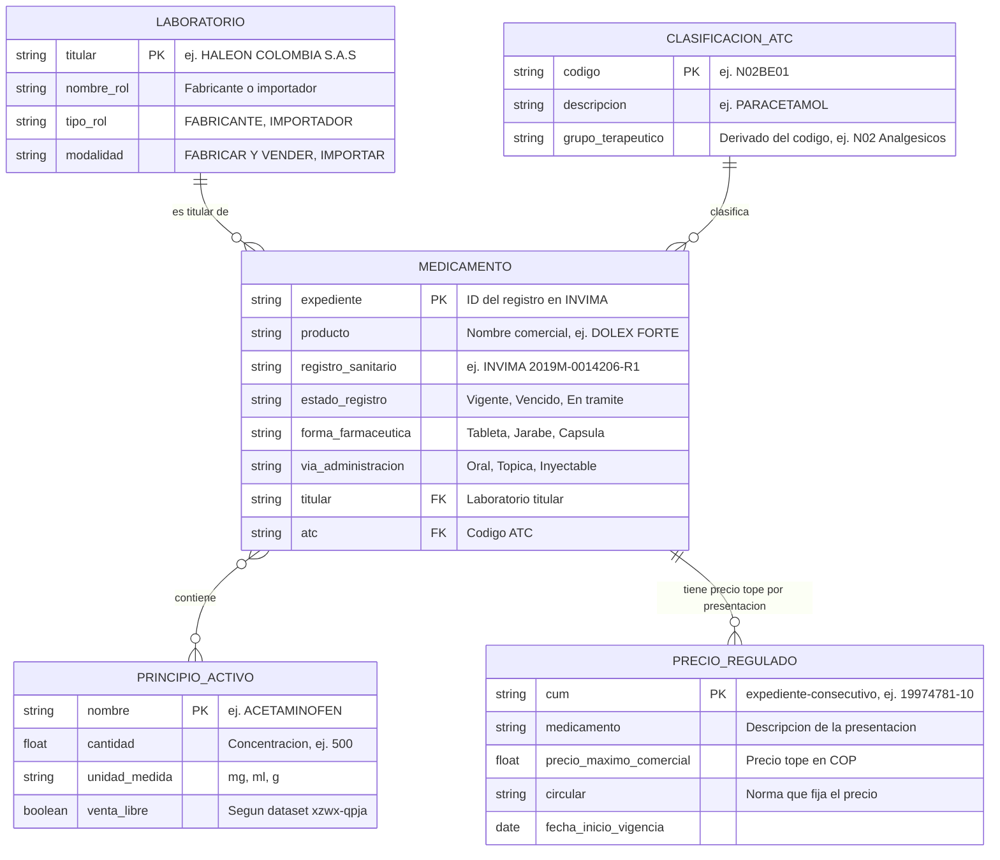
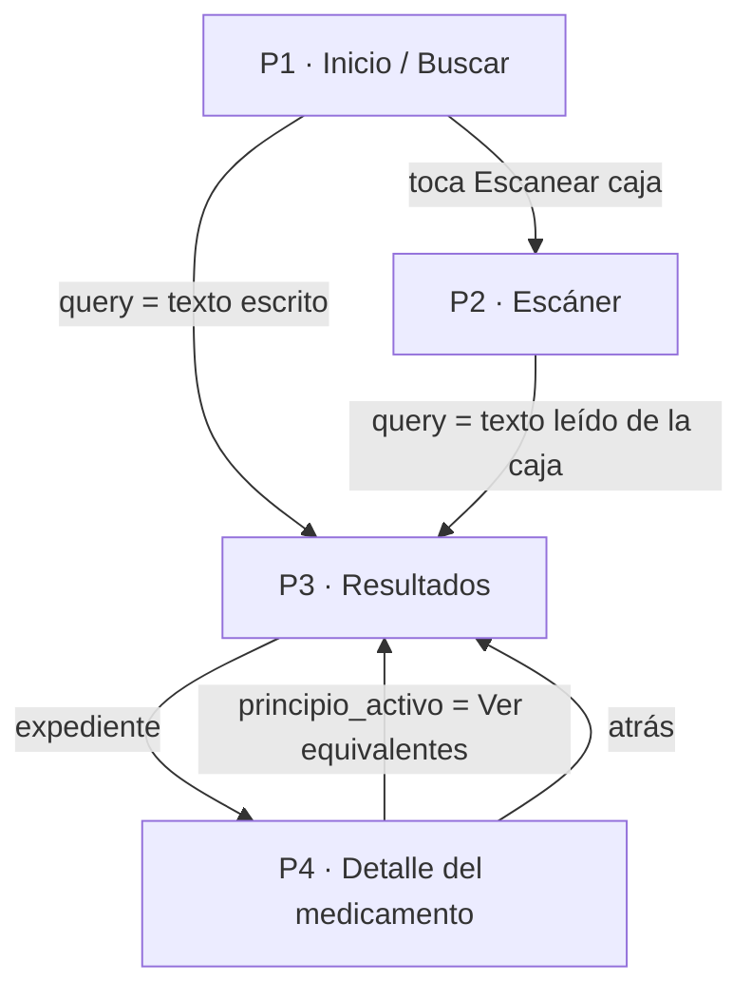
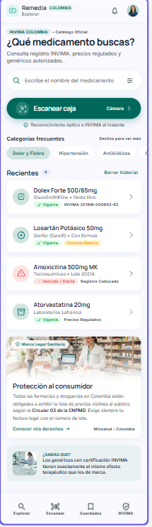
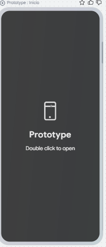
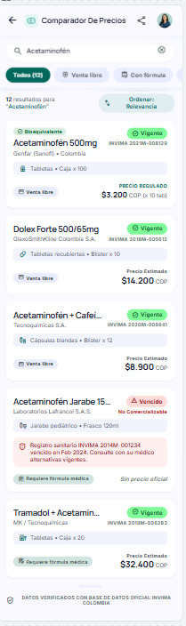
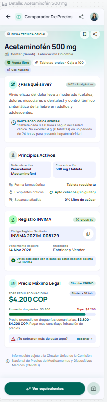
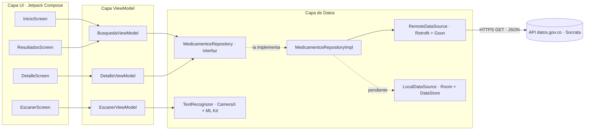

# 💊 Remedia

> **Toma una foto de la caja o escribe el nombre de un medicamento y entérate qué es, para qué sirve, si necesitas fórmula, cuánto debería costar y qué genéricos equivalentes existen. Con datos oficiales del INVIMA y del Ministerio de Salud.**

Proyecto de diseño y arquitectura de una aplicación móvil Android. Este repositorio contiene:
- **(a)** la app funcional en Kotlin + Jetpack Compose, con arquitectura MVVM, que ya consume la API real de datos.gov.co (ver Hito 4), y
- **(b)** este `README.md`, que documenta todo el diseño de la app.

| | Enlace |
|---|---|
| 🎨 Prototipo en Google Stitch | https://stitch.withgoogle.com/projects/2507496012775443897 |


## 👥 Equipo

| Integrante         | Rol en el proyecto |
|--------------------|---|
| Yhojan Caro        | Líder del repositorio · Idea, API y modelo de datos |
| Sebastian Gonzalez | Diseño UI/UX en Google Stitch · Flujo de navegación |
| Emanuel Castaño    | Arquitectura MVVM · Endpoints · Proyecto base |

---

## 📌 Tabla de contenido

1. [Hito 1 · Elevator Pitch y API](#-hito-1--elevator-pitch-y-api)
2. [Hito 2 · Modelo de datos (ER)](#-hito-2--modelo-de-datos-er)
3. [Hito 3 · Pantallas y flujo de navegación](#-hito-3--pantallas-y-flujo-de-navegación)
4. [Hito 4 · Arquitectura y endpoints](#-hito-4--arquitectura-y-endpoints)
5. [Hito 5 · Proyecto base en Android Studio](#-hito-5--proyecto-base-en-android-studio)
6. [Hito 6 · Video de presentación](#-hito-6--video-de-presentación)
7. [Hito 7 · Gestión del repositorio (GitHub Flow)](#-hito-7--gestión-del-repositorio-github-flow)
8. [Aviso importante](#aviso-importante)

---

## 🚀 Hito 1 · Elevator Pitch y API

### Elevator Pitch

> *"Nuestra app se llama **Remedia** y consume la **API de Datos Abiertos de Colombia (datos.gov.co)**, con la información oficial del INVIMA y del Ministerio de Salud. El problema que resolvemos es que las personas reciben medicamentos que no conocen. No saben qué contienen, si existe un genérico más barato, si pueden comprarlos sin fórmula ni cuál es su precio máximo legal. Con Remedia basta con tomarle una foto a la caja o escribir el nombre. Usaremos 4 recursos de la API: **Medicamento, Principio Activo, Laboratorio y Clasificación ATC**, más el **Precio Regulado** como recurso complementario."*

### El problema

- En Colombia los medicamentos se conocen por su **nombre comercial** (Dolex, Advil, Losartán MK), pero lo que importa es el **principio activo**. El mismo acetaminofén se vende con más de 200 registros distintos.
- La gente paga de más porque **no sabe que existe un equivalente** con el mismo principio activo y la misma concentración.
- No es fácil saber si un medicamento **requiere fórmula médica** ni si su **registro INVIMA está vigente**.
- El Gobierno regula el **precio máximo de venta** de miles de medicamentos, pero casi nadie lo consulta.

### ¿Por qué una app móvil?

- La consulta ocurre **en la droguería o en la casa, con la caja en la mano**. Nadie prende un computador para eso.
- Usa la **cámara** para leer el nombre de la caja, lo cual es más rápido que escribir nombres difíciles como "hidroclorotiazida".
- Guarda el **historial** de medicamentos consultados (por ejemplo, los de un familiar) para tenerlos siempre a la mano.

### API elegida

| | |
|---|---|
| **API** | Portal de Datos Abiertos de Colombia, sobre la plataforma Socrata (SODA API) |
| **URL base** | `https://www.datos.gov.co/resource/` |
| **Autenticación** | No requiere API key para funcionar. Opcionalmente admite una **key de Socrata** (Key ID + Key Secret, enviada con autenticación Basic en el header `Authorization`) para tener más cupo de peticiones. Ver [Key opcional de Socrata](#-key-opcional-de-socrata) |
| **Formato** | JSON |
| **Costo** | Gratis |
| **Fuente de los datos** | INVIMA y Ministerio de Salud y Protección Social |

**Conjuntos de datos (datasets) que consume la app:**

| Dataset | ID | Uso en la app |
|---|---|---|
| Código Único de Medicamentos (CUM) Vigentes | `i7cb-raxc` | Búsqueda, detalle, principios activos, laboratorio, ATC, equivalentes |
| Precio máximo de venta de los medicamentos por presentación comercial | `nauz-qkjw` | Precio tope legal |
| Listado de medicamentos de venta libre | `xzwx-qpja` | Saber si se puede comprar sin fórmula |

---

## 🗂️ Hito 2 · Modelo de datos (ER)



### Relaciones

| Relación | Cardinalidad | Explicación |
|---|---|---|
| Laboratorio → Medicamento | **1:N** | Un laboratorio es titular de muchos medicamentos. Cada medicamento tiene un solo titular. |
| Clasificación ATC → Medicamento | **1:N** | Un código ATC (ej. N02BE01, paracetamol) agrupa muchos medicamentos. Cada medicamento tiene un código ATC. |
| Medicamento ↔ Principio Activo | **N:M** | Un medicamento puede combinar varios principios activos (ej. Dolex Gripa). Un principio activo está presente en muchos medicamentos. Esta relación es la que permite **encontrar equivalentes**. |
| Medicamento → Precio Regulado | **1:N** | Un medicamento tiene varias presentaciones (caja x10, x30...). Cada presentación regulada tiene su propio precio máximo. Algunos medicamentos no tienen precio regulado, por eso la relación es opcional (`o{`). |

### ¿Cómo se obtiene cada entidad de la API?

La API entrega una fila por cada combinación de *presentación + principio activo*. La app **agrupa** esas filas para construir las entidades:

| Entidad | Campos de la API (dataset `i7cb-raxc`, salvo que se indique) |
|---|---|
| Medicamento | `expediente`, `producto`, `registrosanitario`, `estadoregistro`, `formafarmaceutica`, `viaadministracion` |
| Principio Activo | `principioactivo`, `cantidad`, `unidadmedida` · venta libre desde `xzwx-qpja` |
| Laboratorio | `titular`, `nombrerol`, `tiporol`, `modalidad` |
| Clasificación ATC | `atc`, `descripcionatc` |
| Precio Regulado | Dataset `nauz-qkjw`: `cum`, `medicamento`, `precio_maximo_de_venta_transaccion_final_comercial`, `circular_cnpmdm`, `fecha_de_inicio_vigencia_precio_maximo_de_venta` |

> 💡 **¿Para qué sirve el medicamento?** El código ATC es la clasificación internacional de la OMS que indica sobre qué órgano o sistema actúa el medicamento y su grupo terapéutico. Por ejemplo, `N02` = Analgésicos y `C09` = Antihipertensivos. La app traduce los primeros caracteres del código a una descripción en lenguaje sencillo.

---

## 📱 Hito 3 · Pantallas y flujo de navegación

🎨 **Prototipo interactivo en Google Stitch:** **https://stitch.withgoogle.com/projects/2507496012775443897**

### Flujo de navegación



### Pantalla 1 · Inicio / Buscar



| | |
|---|---|
| **Qué muestra** | Barra de búsqueda, botón grande "📷 Escanear caja" y una lista de **medicamentos consultados recientemente** (de esta sesión). |
| **Datos** | Los recientes se guardan en `BusquedaViewModel` y se persisten con **DataStore** (JSON ordenado, máximo 10), así que sobreviven a la rotación y a que se mate el proceso. Esta pantalla no llama a la API directamente. |
| **Acciones** | Escribir un nombre y buscar → **P3** enviando `query`. Tocar "Escanear" → **P2**. Tocar un reciente → **P3**, repitiendo esa búsqueda como `query`. |

### Pantalla 2 · Escáner



| | |
|---|---|
| **Qué muestra** | Vista previa real de la cámara con un recuadro guía ("Enfoca el nombre del medicamento"), el texto detectado en tiempo real y el botón "Buscar este medicamento" cuando confirmas con el obturador. |
| **Datos** | No llama a la API. **CameraX** enlaza preview y análisis al ciclo de vida; **ML Kit Text Recognition** (modelo incluido en el APK) lee los bloques de texto y `TextoMedicamentoExtractor` elige la línea con el nombre, descartando registros, lotes y números. El permiso `CAMERA` se pide al entrar y se puede volver a pedir desde "Reintentar". |
| **Acciones** | Confirmar el texto detectado → **P3** enviando `query` (con `popUpTo Inicio`). "Escribir el nombre" y la flecha vuelven a Inicio. Si se niega el permiso o falla la cámara, se muestra el motivo y un botón de reintento. |

### Pantalla 3 · Resultados (lista principal)



| | |
|---|---|
| **Qué muestra** | Lista (`LazyColumn`) de medicamentos. Cada tarjeta muestra el nombre comercial, el laboratorio, la forma farmacéutica, el estado (🟢 Vigente / 🔴 Vencido) y la etiqueta **VENTA LIBRE / REQUIERE FÓRMULA** calculada desde el catálogo de venta libre. Tiene filtros por tipo de venta (Todos / Venta libre / Con fórmula). |
| **Endpoints** | `GET i7cb-raxc.json?$q={query}` con `$select=expediente,producto,titular,estadoregistro,formafarmaceutica,descripcionatc,principioactivo`. "Ver equivalentes" reutiliza este mismo endpoint, enviando el principio activo como `query` en vez de un endpoint separado. |
| **Acciones** | Tocar un medicamento → **P4** enviando `expediente`. Estados: *Cargando* (skeleton), *Éxito* (lista), *Vacío* ("No encontramos ese medicamento") y *Error* (botón "Reintentar"). |

### Pantalla 4 · Detalle del medicamento



| | |
|---|---|
| **Qué muestra** | Nombre comercial; **para qué sirve** (grupo ATC en lenguaje sencillo); **principios activos**; insignia **"Venta libre" / "Requiere fórmula"**; laboratorio; registro INVIMA y su estado; precio máximo legal cuando existe; botón **"Ver equivalentes"**. |
| **Endpoints** | `GET i7cb-raxc.json?expediente={expediente}`, `GET nauz-qkjw.json?$where=starts_with(cum, '{expediente}-')` y `GET xzwx-qpja.json?$select=principioactivo` (catálogo de venta libre, descargado una sola vez por sesión). Precio y venta libre se consultan en paralelo. |
| **Acciones** | "Ver equivalentes" → **P3** enviando `principio_activo`. El ícono "Compartir" ya está en la UI, pero su acción todavía no está implementada. No hay botón de "Guardar/favoritos" en esta versión. |

---

## 🏗️ Hito 4 · Arquitectura y endpoints

### Diagrama de arquitectura (MVVM)



### Responsabilidad de cada capa

| Capa | Responsabilidad |
|---|---|
| **UI (Jetpack Compose)** | Dibuja las pantallas y observa el estado del ViewModel. No contiene lógica de negocio. |
| **ViewModel** | Guarda el estado de cada pantalla (`UiState`) y sobrevive a la rotación. Lanza las corrutinas y llama al repositorio. |
| **Repository** | Es una **interfaz** (`MedicamentosRepository`, con `buscar` y `cargarDetalle`) y una implementación (`MedicamentosRepositoryImpl`). Los ViewModels dependen de la interfaz, no de Retrofit. Fuente única de verdad. Por ahora solo trae datos de la API y **agrupa las filas** en las entidades del modelo (Medicamento, Principio Activo...); decidir entre API y base local es trabajo pendiente. |
| **RemoteDataSource** | Interfaz de Retrofit con los endpoints de datos.gov.co. **Implementado** (`MedicamentosApi` + `RetrofitClient`). |
| **LocalDataSource** | DataStore para el historial de recientes (**implementado**). Room para favoritos y caché sin conexión; **pendiente**. |
| **TextRecognizer** | **Implementado**: el analizador de CameraX entrega cada frame a ML Kit; el ViewModel recibe solo `List<String>`, elige la mejor línea y el obturador la confirma. La lógica de extracción es pura y se prueba sin cámara. |

### Buenas prácticas planificadas

| Práctica | Cómo se aplicará en Remedia |
|---|---|
| **Patrón MVVM** | UI → ViewModel → Repository → Fuente remota/local, como en el diagrama. |
| **Cliente HTTP** | **Retrofit** con convertidor **Gson**. Los parámetros de Socrata (`$q`, `$where`, `$select`, `$limit`) se envían como `@Query`. |
| **Asincronía** | **Kotlin Coroutines**: funciones `suspend` (las de Retrofit en `MedicamentosApi`), lanzadas desde `viewModelScope`. No se usa `Dispatchers` en ningún lado: Retrofit ejecuta la red fuera del hilo principal por dentro, así que llamar sus funciones `suspend` desde el hilo principal es seguro. |
| **Estados de UI** | Cada pantalla maneja **Loading / Success / Error** (más *Empty* en Resultados) con un `UiState` observado por Compose. |
| **Seguridad** | La API no exige key. Si se usa la key opcional de Socrata (`SOCRATA_KEY_ID` y `SOCRATA_KEY_SECRET`), va en `local.properties` (excluido por `.gitignore`) y se inyecta con `BuildConfig`. **Nunca se sube al repositorio**, y como todo `BuildConfig` es extraíble del APK: trátala como configuración pública de solo lectura, no como secreto. Ver [Key opcional de Socrata](#-key-opcional-de-socrata). |
| **Corrutinas** | Las búsquedas cancelan el `Job` anterior, relanzan `CancellationException` (nunca la convierten en error) y cachean el estado por consulta para no repetir peticiones al volver del Detalle. |
| **Permisos** | El permiso `CAMERA` se pide en tiempo de ejecución al entrar en el Escáner (es decir, después de tocar "Escanear"). Si se niega, se muestra un mensaje y se puede volver a pedir; la app sigue funcionando con el buscador de texto. |
| **Paginación** | `$limit` y `$offset` para no descargar miles de registros a la vez. |

### Librerías

| Librería | Uso | Estado |
|---|---|---|
| Jetpack Compose + Navigation Compose | UI declarativa y navegación entre pantallas, con rutas type-safe y argumentos tipados (`consulta`, `expediente`) | ✅ Implementada |
| Kotlinx Serialization | Rutas type-safe (`@Serializable`) para Navigation Compose | ✅ Implementada |
| Lifecycle ViewModel (Compose) | ViewModels conscientes del ciclo de vida | ✅ Implementada |
| Retrofit + Gson | Consumo de la API REST y conversión de JSON | ✅ Implementada |
| OkHttp Logging Interceptor | Depurar las peticiones durante el desarrollo | ✅ Implementada |
| Kotlin Coroutines | Asincronía (`viewModelScope`, funciones `suspend`) | ✅ Implementada |
| Room | Favoritos y caché de medicamentos sin conexión | 🔲 Pendiente |
| DataStore | Historial de recientes (✅ Implementado) y preferencias del usuario | 🔶 Parcial |
| CameraX | Vista previa real y análisis de frames (1.3.4), enlazada al ciclo de vida | ✅ Implementada |
| ML Kit Text Recognition | Lectura de texto del empaque (modelo incluido, 16.0.1) | ✅ Implementada |
| Coil | Cargar imágenes (íconos por forma farmacéutica) | 🔲 Pendiente |

### Tabla de endpoints

URL base: `https://www.datos.gov.co/resource/`

| # | Endpoint | Método HTTP | Parámetros | Propósito en la App | Pantalla |
|---|---|---|---|---|---|
| 1 | `i7cb-raxc.json` | GET | `$q={texto}`, `$select=expediente,producto,titular,estadoregistro,formafarmaceutica,descripcionatc,principioactivo`, `$group=` (mismos campos), `$limit=50` | **Buscar medicamentos** por nombre comercial, escrito o leído de la foto. También se usa para **equivalentes**, enviando el principio activo como `$q` (no hay un endpoint separado). | P3 |
| 2 | `i7cb-raxc.json` | GET | `expediente={expediente}`, `$limit=1` | **Detalle**: principio activo, laboratorio, ATC y registro del medicamento | P4 |
| 3 | `nauz-qkjw.json` | GET | `$where=starts_with(cum, '{expediente}-')` | **Precio máximo legal** de cada presentación | P4 |
| 4 | `xzwx-qpja.json` | GET | `$select=principioactivo`, `$limit=5000` | Catálogo de **venta libre**: una sola petición por sesión, reutilizada por la lista (filtros y badge) y el detalle | P3 y P4 |

**Ejemplos reales** (se pueden abrir en el navegador):
- Buscar "Dolex": <https://www.datos.gov.co/resource/i7cb-raxc.json?$q=dolex&$limit=5>
- Detalle de Dolex Activgel: <https://www.datos.gov.co/resource/i7cb-raxc.json?expediente=20058810>
- Equivalentes del acetaminofén: <https://www.datos.gov.co/resource/i7cb-raxc.json?principioactivo=ACETAMINOFEN&$limit=10>

**Ejemplo de respuesta** (endpoint 2, resumido):

```json
{
  "expediente": "20058810",
  "producto": "DOLEX® ACTIVGEL",
  "titular": "HALEON COLOMBIA S.A.S",
  "registrosanitario": "INVIMA 2019M-0014206-R1",
  "estadoregistro": "Vigente",
  "atc": "N02BE01",
  "descripcionatc": "PARACETAMOL",
  "principioactivo": "ACETAMINOFEN",
  "cantidad": "500",
  "unidadmedida": "mg",
  "formafarmaceutica": "CAPSULA BLANDA",
  "viaadministracion": "ORAL"
}
```

### 🔑 Key opcional de Socrata

La API **funciona sin ninguna key**. Con una key de Socrata se obtiene más cupo de peticiones. Para usarla, agrega esto en `local.properties` (archivo excluido por `.gitignore`, no se sube a Git):

```properties
SOCRATA_KEY_ID=tu_key_id
SOCRATA_KEY_SECRET=tu_key_secret
```

`app/build.gradle.kts` las lee y las expone como `BuildConfig.SOCRATA_KEY_ID` y `BuildConfig.SOCRATA_KEY_SECRET`. `RetrofitClient` agrega el header `Authorization` (Basic) **solo si ambas tienen valor**. Si faltan o están vacías, la petición sale sin header y la app funciona igual. Estos valores quedan compilados en el APK y se pueden extraer: son una key pública y opcional de solo lectura, no un secreto. Si necesitaras una credencial realmente privada, debes proxyarla por un backend.

---

## 🧱 Hito 5 · Proyecto base en Android Studio

| Configuración | Valor |
|---|---|
| Plantilla | Empty Activity (Jetpack Compose) |
| Nombre | Remedia |
| Package name | `com.example.remedia` |
| Lenguaje | Kotlin |
| Build configuration language | Kotlin DSL (`build.gradle.kts`) |
| Minimum SDK | API 24 (Android 7.0) |

✅ El **commit inicial** subió el proyecto tal cual lo genera Android Studio (evidencia más abajo). Desde entonces el proyecto evolucionó y **hoy incluye la implementación completa**: pantallas en Compose, ViewModels con `StateFlow`, repositorio (interfaz + implementación), cliente Retrofit y navegación type-safe. `MainActivity` solo llama a `AppNavigation()` dentro de `RemediaTheme`.

Explicación detallada de cada archivo y del flujo de datos: [docs/tutorial_arquitectura.md](docs/tutorial_arquitectura.md).

### Estructura de carpetas actual

```text
com.example.remedia/
├── MainActivity.kt
├── data/
│   ├── api/          MedicamentosApi.kt
│   ├── dto/          MedicamentoDto.kt, PrecioDto.kt
│   ├── model/        Medicamento.kt
│   ├── network/      RetrofitClient.kt
│   └── repository/   MedicamentosRepository.kt (interfaz),
│                     MedicamentosRepositoryImpl.kt
├── presentation/
│   ├── components/   8 componentes reutilizables
│   ├── navigation/   Destinations.kt, AppNavigation.kt
│   ├── screens/      Inicio, Resultados, Detalle, Escaner
│   └── viewmodel/    BusquedaViewModel, DetalleViewModel, EscanerViewModel, EstadoUi
└── ui/theme/
```

**Evidencia, el proyecto corriendo en el emulador:**


🔗 **Commit inicial:** **[PEGAR ENLACE AL COMMIT INICIAL]**

---

## 🎬 Hito 6 · Video de presentación

▶️ **[PEGAR ENLACE DE YOUTUBE / GOOGLE DRIVE]** · Duración: **[mm:ss]** (máximo 5:00)

| Integrante | Tema que expone |
|---|---|
| Yhojan Caro | Problema, API de datos.gov.co y diagrama ER |
| Sebastian Gozalez | Prototipo en Google Stitch y flujo de navegación |
| Emanuel Castaño | Arquitectura MVVM, endpoints y proyecto base corriendo |

---

## 🌿 Hito 7 · Gestión del repositorio (GitHub Flow)

- **Repositorio:** `android-design-remedia` (público). Todos los integrantes son colaboradores con permiso de escritura.
- **Rama principal:** `main`, protegida. Solo recibe cambios por Pull Request.
- **Flujo:** una rama por hito → Pull Request → revisión de **otro** integrante → merge a `main`.

| Rama | Contenido | Autor | Revisor |
|---|---|---|---|
| `main` (commit inicial) | Proyecto base autogenerado | Emanuel Castaño | — |
| `docs/hito-1-pitch-api` | Pitch, problema y API | Yhojan Caro | Sebastian Gozalez |
| `docs/hito-2-diagrama-er` | Diagrama ER en Mermaid | Yhojan Caro | Emanuel Castaño |
| `docs/hito-3-pantallas-stitch` | Pantallas, capturas y flujo de navegación | Sebastian Gozalez | Yhojan Caro |
| `docs/hito-4-arquitectura-endpoints` | Diagrama MVVM y tabla de endpoints | Emanuel Castaño | Sebastian Gozalez |
| `docs/hito-5-evidencia-proyecto-base` | Screenshot del emulador y enlace al commit | Emanuel Castaño | Yhojan Caro |
| `docs/hito-6-video` | Enlace al video | Sebastian Gozalez | Emanuel Castaño |

🔗 **Pull Requests:** **[PEGAR ENLACE A LA PESTAÑA DE PULL REQUESTS CERRADOS]**

---

## Aviso importante

Remedia es una herramienta **informativa**. **No reemplaza la indicación de un médico ni de un químico farmacéutico.** Los datos provienen de fuentes oficiales abiertas y pueden tener retrasos en su actualización. Antes de cambiar o tomar un medicamento, consulta con un profesional de la salud.

## 📚 Fuentes

- [Portal de Datos Abiertos de Colombia](https://www.datos.gov.co)
- [Documentación de la API Socrata (SODA)](https://dev.socrata.com/)
- [INVIMA: Registros sanitarios de medicamentos](https://www.invima.gov.co/)
- [Minsalud: Termómetro de precios de medicamentos](https://minsalud.gov.co/salud/medicamentos-y-tecnologias/Paginas/termometro-de-precios.aspx)
- [Clasificación ATC de la OMS](https://atcddd.fhi.no/atc_ddd_index/)