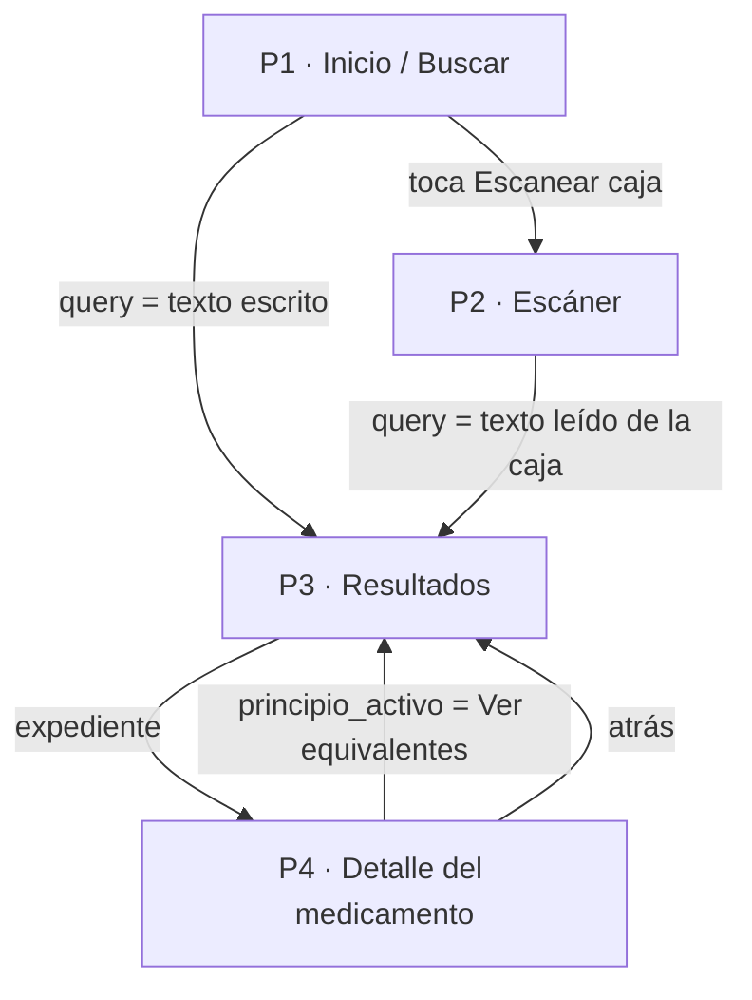
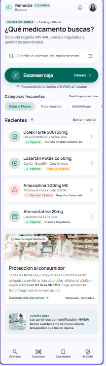
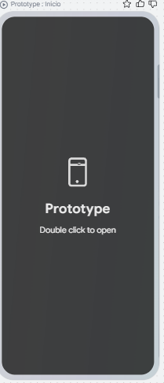
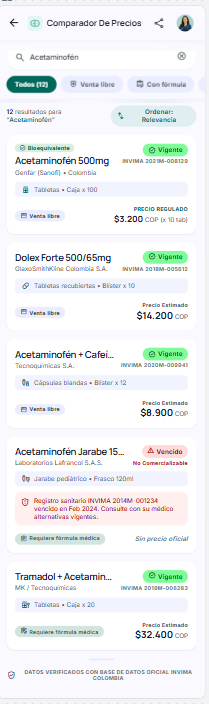
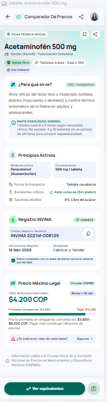
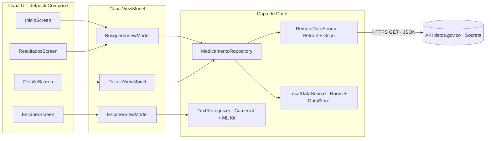

# 💊 Remedia

> **Toma una foto de la caja o escribe el nombre de un medicamento y entérate qué es, para qué sirve, si necesitas fórmula, cuánto debería costar y qué genéricos equivalentes existen. Con datos oficiales del INVIMA y del Ministerio de Salud.**

Proyecto de diseño y arquitectura de una aplicación móvil Android. Este repositorio contiene:
- **(a)** el proyecto base de Android Studio (Empty Activity, Kotlin, Compose) **sin código de aplicación**, y
- **(b)** este `README.md`, que documenta todo el diseño de la app.

| | Enlace |
|---|---|
| 🎨 Prototipo en Google Stitch | https://stitch.withgoogle.com/projects/2507496012775443897 |
| 🎬 Video de presentación | **[PEGAR ENLACE DE YOUTUBE / DRIVE]** |

## 👥 Equipo

| Integrante | Rol en el proyecto |
|---|---|
| Yhojan Caro | Líder del repositorio · Idea, API y modelo de datos |
| Sebastian Gozalez | Diseño UI/UX en Google Stitch · Flujo de navegación |
| Emanuel Castaño | Arquitectura MVVM · Endpoints · Proyecto base |

---

## 📌 Tabla de contenido

1. [Hito 1 · Elevator Pitch y API](#-hito-1--elevator-pitch-y-api)
2. [Hito 2 · Modelo de datos (ER)](#-hito-2--modelo-de-datos-er)
3. [Hito 3 · Pantallas y flujo de navegación](#-hito-3--pantallas-y-flujo-de-navegación)
4. [Hito 4 · Arquitectura y endpoints](#-hito-4--arquitectura-y-endpoints)
5. [Hito 5 · Proyecto base en Android Studio](#-hito-5--proyecto-base-en-android-studio)
6. [Hito 6 · Video de presentación](#-hito-6--video-de-presentación)
7. [Hito 7 · Gestión del repositorio (GitHub Flow)](#-hito-7--gestión-del-repositorio-github-flow)
8. [Aviso importante](#aviso-importante)

---

## 🚀 Hito 1 · Elevator Pitch y API

### Elevator Pitch

> *"Nuestra app se llama **Remedia** y consume la **API de Datos Abiertos de Colombia (datos.gov.co)**, con la información oficial del INVIMA y del Ministerio de Salud. El problema que resolvemos es que las personas reciben medicamentos que no conocen. No saben qué contienen, si existe un genérico más barato, si pueden comprarlos sin fórmula ni cuál es su precio máximo legal. Con Remedia basta con tomarle una foto a la caja o escribir el nombre. Usaremos 4 recursos de la API: **Medicamento, Principio Activo, Laboratorio y Clasificación ATC**, más el **Precio Regulado** como recurso complementario."*

### El problema

- En Colombia los medicamentos se conocen por su **nombre comercial** (Dolex, Advil, Losartán MK), pero lo que importa es el **principio activo**. El mismo acetaminofén se vende con más de 200 registros distintos.
- La gente paga de más porque **no sabe que existe un equivalente** con el mismo principio activo y la misma concentración.
- No es fácil saber si un medicamento **requiere fórmula médica** ni si su **registro INVIMA está vigente**.
- El Gobierno regula el **precio máximo de venta** de miles de medicamentos, pero casi nadie lo consulta.

### ¿Por qué una app móvil?

- La consulta ocurre **en la droguería o en la casa, con la caja en la mano**. Nadie prende un computador para eso.
- Usa la **cámara** para leer el nombre de la caja, lo cual es más rápido que escribir nombres difíciles como "hidroclorotiazida".
- Guarda el **historial** de medicamentos consultados (por ejemplo, los de un familiar) para tenerlos siempre a la mano.

### API elegida

| | |
|---|---|
| **API** | Portal de Datos Abiertos de Colombia, sobre la plataforma Socrata (SODA API) |
| **URL base** | `https://www.datos.gov.co/resource/` |
| **Autenticación** | No requiere API key. Se puede usar un *App Token* gratuito (header `X-App-Token`) para tener un límite de peticiones más alto |
| **Formato** | JSON |
| **Costo** | Gratis |
| **Fuente de los datos** | INVIMA y Ministerio de Salud y Protección Social |

**Conjuntos de datos (datasets) que consume la app:**

| Dataset | ID | Uso en la app |
|---|---|---|
| Código Único de Medicamentos (CUM) Vigentes | `i7cb-raxc` | Búsqueda, detalle, principios activos, laboratorio, ATC, equivalentes |
| Precio máximo de venta de los medicamentos por presentación comercial | `nauz-qkjw` | Precio tope legal |
| Listado de medicamentos de venta libre | `xzwx-qpja` | Saber si se puede comprar sin fórmula |

---

## 🗂️ Hito 2 · Modelo de datos (ER)

```mermaid
erDiagram
    LABORATORIO ||--o{ MEDICAMENTO : "es titular de"
    CLASIFICACION_ATC ||--o{ MEDICAMENTO : "clasifica"
    MEDICAMENTO }o--o{ PRINCIPIO_ACTIVO : "contiene"
    MEDICAMENTO ||--o{ PRECIO_REGULADO : "tiene precio tope por presentacion"

    MEDICAMENTO {
        string expediente PK "ID del registro en INVIMA"
        string producto "Nombre comercial, ej. DOLEX FORTE"
        string registro_sanitario "ej. INVIMA 2019M-0014206-R1"
        string estado_registro "Vigente, Vencido, En tramite"
        string forma_farmaceutica "Tableta, Jarabe, Capsula"
        string via_administracion "Oral, Topica, Inyectable"
        string titular FK "Laboratorio titular"
        string atc FK "Codigo ATC"
    }
    PRINCIPIO_ACTIVO {
        string nombre PK "ej. ACETAMINOFEN"
        float cantidad "Concentracion, ej. 500"
        string unidad_medida "mg, ml, g"
        boolean venta_libre "Segun dataset xzwx-qpja"
    }
    LABORATORIO {
        string titular PK "ej. HALEON COLOMBIA S.A.S"
        string nombre_rol "Fabricante o importador"
        string tipo_rol "FABRICANTE, IMPORTADOR"
        string modalidad "FABRICAR Y VENDER, IMPORTAR"
    }
    CLASIFICACION_ATC {
        string codigo PK "ej. N02BE01"
        string descripcion "ej. PARACETAMOL"
        string grupo_terapeutico "Derivado del codigo, ej. N02 Analgesicos"
    }
    PRECIO_REGULADO {
        string cum PK "expediente-consecutivo, ej. 19974781-10"
        string medicamento "Descripcion de la presentacion"
        float precio_maximo_comercial "Precio tope en COP"
        string circular "Norma que fija el precio"
        date fecha_inicio_vigencia
    }
```



### Relaciones

| Relación | Cardinalidad | Explicación |
|---|---|---|
| Laboratorio → Medicamento | **1:N** | Un laboratorio es titular de muchos medicamentos. Cada medicamento tiene un solo titular. |
| Clasificación ATC → Medicamento | **1:N** | Un código ATC (ej. N02BE01, paracetamol) agrupa muchos medicamentos. Cada medicamento tiene un código ATC. |
| Medicamento ↔ Principio Activo | **N:M** | Un medicamento puede combinar varios principios activos (ej. Dolex Gripa). Un principio activo está presente en muchos medicamentos. Esta relación es la que permite **encontrar equivalentes**. |
| Medicamento → Precio Regulado | **1:N** | Un medicamento tiene varias presentaciones (caja x10, x30...). Cada presentación regulada tiene su propio precio máximo. Algunos medicamentos no tienen precio regulado, por eso la relación es opcional (`o{`). |

### ¿Cómo se obtiene cada entidad de la API?

La API entrega una fila por cada combinación de *presentación + principio activo*. La app **agrupa** esas filas para construir las entidades:

| Entidad | Campos de la API (dataset `i7cb-raxc`, salvo que se indique) |
|---|---|
| Medicamento | `expediente`, `producto`, `registrosanitario`, `estadoregistro`, `formafarmaceutica`, `viaadministracion` |
| Principio Activo | `principioactivo`, `cantidad`, `unidadmedida` · venta libre desde `xzwx-qpja` |
| Laboratorio | `titular`, `nombrerol`, `tiporol`, `modalidad` |
| Clasificación ATC | `atc`, `descripcionatc` |
| Precio Regulado | Dataset `nauz-qkjw`: `cum`, `medicamento`, `precio_maximo_de_venta_transaccion_final_comercial`, `circular_cnpmdm`, `fecha_de_inicio_vigencia_precio_maximo_de_venta` |

> 💡 **¿Para qué sirve el medicamento?** El código ATC es la clasificación internacional de la OMS que indica sobre qué órgano o sistema actúa el medicamento y su grupo terapéutico. Por ejemplo, `N02` = Analgésicos y `C09` = Antihipertensivos. La app traduce los primeros caracteres del código a una descripción en lenguaje sencillo.

---

## 📱 Hito 3 · Pantallas y flujo de navegación

🎨 **Prototipo interactivo en Google Stitch:** **https://stitch.withgoogle.com/projects/2507496012775443897**

### Flujo de navegación



### Pantalla 1 · Inicio / Buscar



| | |
|---|---|
| **Qué muestra** | Barra de búsqueda, botón grande "📷 Escanear caja" y una lista de **medicamentos consultados recientemente** (guardados en el celular). |
| **Datos** | Los recientes salen de la base de datos local (Room). Esta pantalla no llama a la API. |
| **Acciones** | Escribir un nombre y buscar → **P3** enviando `query`. Tocar "Escanear" → **P2**. Tocar un reciente → **P4** enviando `expediente`. |

### Pantalla 2 · Escáner



| | |
|---|---|
| **Qué muestra** | Vista de la cámara con un recuadro guía ("Enfoca el nombre del medicamento"), el texto detectado en tiempo real y un botón "Usar este nombre". |
| **Datos** | No llama a la API. Usa **CameraX** y **ML Kit Text Recognition**, que reconoce el texto dentro del celular, sin internet. |
| **Acciones** | Confirmar el texto detectado → **P3** enviando `query`. Si el usuario no da permiso de cámara, muestra un mensaje y la opción de escribir el nombre. |

### Pantalla 3 · Resultados (lista principal)



| | |
|---|---|
| **Qué muestra** | Lista (`LazyColumn`) de medicamentos. Cada tarjeta muestra el nombre comercial, el laboratorio, la forma farmacéutica y una **etiqueta de estado** (🟢 Vigente / 🔴 Vencido). Tiene filtros por forma farmacéutica. |
| **Endpoints** | Búsqueda: `GET i7cb-raxc.json?$q={query}`. Equivalentes: `GET i7cb-raxc.json?principioactivo={nombre}` |
| **Acciones** | Tocar un medicamento → **P4** enviando `expediente`. Estados: *Cargando* (skeleton), *Éxito* (lista), *Vacío* ("No encontramos ese medicamento") y *Error* (botón "Reintentar"). |

### Pantalla 4 · Detalle del medicamento



| | |
|---|---|
| **Qué muestra** | Nombre comercial; **para qué sirve** (grupo ATC en lenguaje sencillo); **principios activos** con su concentración; insignia **"Venta libre" / "Requiere fórmula"**; laboratorio; registro INVIMA y su estado; presentaciones con su **precio máximo legal** cuando existe; botón **"Ver equivalentes"**. |
| **Endpoints** | `GET i7cb-raxc.json?expediente={expediente}`, `GET nauz-qkjw.json?$where=starts_with(cum, '{expediente}-')` y `GET xzwx-qpja.json?$q={principio_activo}` |
| **Acciones** | "Ver equivalentes" → **P3** enviando `principio_activo`. "Guardar" lo añade a recientes y favoritos (Room). "Compartir" envía la información por WhatsApp. |

---

## 🏗️ Hito 4 · Arquitectura y endpoints

### Diagrama de arquitectura (MVVM)



### Responsabilidad de cada capa

| Capa | Responsabilidad |
|---|---|
| **UI (Jetpack Compose)** | Dibuja las pantallas y observa el estado del ViewModel. No contiene lógica de negocio. |
| **ViewModel** | Guarda el estado de cada pantalla (`UiState`) y sobrevive a la rotación. Lanza las corrutinas y llama al repositorio. |
| **Repository** | Fuente única de verdad. Decide si los datos vienen de la API o de la base local, y **agrupa las filas de la API** en las entidades del modelo (Medicamento, Principio Activo...). |
| **RemoteDataSource** | Interfaz de Retrofit con los endpoints de datos.gov.co. |
| **LocalDataSource** | Room para los recientes y favoritos. DataStore para las preferencias del usuario. |
| **TextRecognizer** | Conecta CameraX con ML Kit para extraer el texto de la caja. Funciona sin internet. |

### Buenas prácticas planificadas

| Práctica | Cómo se aplicará en Remedia |
|---|---|
| **Patrón MVVM** | UI → ViewModel → Repository → Fuente remota/local, como en el diagrama. |
| **Cliente HTTP** | **Retrofit** con convertidor **Gson**. Los parámetros de Socrata (`$q`, `$where`, `$select`, `$limit`) se envían como `@Query`. |
| **Asincronía** | **Kotlin Coroutines**: funciones `suspend` en el repositorio, ejecutadas en `Dispatchers.IO`, lanzadas desde `viewModelScope`. |
| **Estados de UI** | Cada pantalla maneja **Loading / Success / Error** (más *Empty* en Resultados) con un `UiState` observado por Compose. |
| **Seguridad** | La API no exige key. Si se usa un *App Token* de Socrata, va en `local.properties` (excluido por `.gitignore`) y se inyecta con `BuildConfig`. **Nunca se sube al repositorio.** |
| **Permisos** | El permiso `CAMERA` se pide en tiempo de ejecución, solo cuando el usuario toca "Escanear". La app funciona igual si lo niega. |
| **Paginación** | `$limit` y `$offset` para no descargar miles de registros a la vez. |

### Librerías previstas

| Librería | Uso |
|---|---|
| Jetpack Compose + Navigation Compose | UI declarativa y navegación entre pantallas, con paso de argumentos (`query`, `expediente`, `principio_activo`) |
| Lifecycle ViewModel | ViewModels conscientes del ciclo de vida |
| Retrofit + Gson | Consumo de la API REST y conversión de JSON |
| OkHttp Logging Interceptor | Depurar las peticiones durante el desarrollo |
| Kotlin Coroutines | Asincronía |
| Room | Historial de recientes y favoritos sin conexión |
| DataStore | Preferencias del usuario |
| CameraX | Vista previa y captura de la cámara |
| ML Kit Text Recognition | Leer el nombre del medicamento desde la foto |
| Coil | Cargar imágenes (íconos por forma farmacéutica) |

### Tabla de endpoints

URL base: `https://www.datos.gov.co/resource/`

| # | Endpoint | Método HTTP | Parámetros | Propósito en la App | Pantalla |
|---|---|---|---|---|---|
| 1 | `i7cb-raxc.json` | GET | `$q={texto}`, `$select=expediente,producto,titular,estadoregistro,formafarmaceutica`, `$group=` (mismos campos), `$limit=50` | **Buscar medicamentos** por nombre comercial, escrito o leído de la foto | P3 |
| 2 | `i7cb-raxc.json` | GET | `expediente={expediente}` | **Detalle**: presentaciones, principios activos, laboratorio, ATC y registro | P4 |
| 3 | `i7cb-raxc.json` | GET | `principioactivo={nombre}`, `estadoregistro=Vigente`, `$select`, `$group`, `$limit=50` | **Equivalentes**: otros medicamentos con el mismo principio activo | P3 |
| 4 | `nauz-qkjw.json` | GET | `$where=starts_with(cum, '{expediente}-')` | **Precio máximo legal** de cada presentación | P4 |
| 5 | `xzwx-qpja.json` | GET | `$q={principio_activo}` | Saber si el principio activo es de **venta libre** | P4 |

**Ejemplos reales** (se pueden abrir en el navegador):
- Buscar "Dolex": <https://www.datos.gov.co/resource/i7cb-raxc.json?$q=dolex&$limit=5>
- Detalle de Dolex Activgel: <https://www.datos.gov.co/resource/i7cb-raxc.json?expediente=20058810>
- Equivalentes del acetaminofén: <https://www.datos.gov.co/resource/i7cb-raxc.json?principioactivo=ACETAMINOFEN&$limit=10>

**Ejemplo de respuesta** (endpoint 2, resumido):

```json
{
  "expediente": "20058810",
  "producto": "DOLEX® ACTIVGEL",
  "titular": "HALEON COLOMBIA S.A.S",
  "registrosanitario": "INVIMA 2019M-0014206-R1",
  "estadoregistro": "Vigente",
  "atc": "N02BE01",
  "descripcionatc": "PARACETAMOL",
  "principioactivo": "ACETAMINOFEN",
  "cantidad": "500",
  "unidadmedida": "mg",
  "formafarmaceutica": "CAPSULA BLANDA",
  "viaadministracion": "ORAL"
}
```

---

## 🧱 Hito 5 · Proyecto base en Android Studio

| Configuración | Valor |
|---|---|
| Plantilla | Empty Activity (Jetpack Compose) |
| Nombre | Remedia |
| Package name | `com.[equipo].remedia` |
| Lenguaje | Kotlin |
| Build configuration language | Kotlin DSL (`build.gradle.kts`) |
| Minimum SDK | API 24 (Android 7.0) |

✅ El proyecto se subió **tal cual lo genera Android Studio**. No tiene clases, paquetes ni lógica adicional, y `MainActivity` no fue modificada.

**Evidencia, el proyecto corriendo en el emulador:**


🔗 **Commit inicial:** **[PEGAR ENLACE AL COMMIT INICIAL]**

---

## 🎬 Hito 6 · Video de presentación

▶️ **[PEGAR ENLACE DE YOUTUBE / GOOGLE DRIVE]** · Duración: **[mm:ss]** (máximo 5:00)

| Integrante | Tema que expone |
|---|---|
| Yhojan Caro | Problema, API de datos.gov.co y diagrama ER |
| Sebastian Gozalez | Prototipo en Google Stitch y flujo de navegación |
| Emanuel Castaño | Arquitectura MVVM, endpoints y proyecto base corriendo |

---

## 🌿 Hito 7 · Gestión del repositorio (GitHub Flow)

- **Repositorio:** `android-design-remedia` (público). Todos los integrantes son colaboradores con permiso de escritura.
- **Rama principal:** `main`, protegida. Solo recibe cambios por Pull Request.
- **Flujo:** una rama por hito → Pull Request → revisión de **otro** integrante → merge a `main`.

| Rama | Contenido | Autor | Revisor |
|---|---|---|---|
| `main` (commit inicial) | Proyecto base autogenerado | Emanuel Castaño | — |
| `docs/hito-1-pitch-api` | Pitch, problema y API | Yhojan Caro | Sebastian Gozalez |
| `docs/hito-2-diagrama-er` | Diagrama ER en Mermaid | Yhojan Caro | Emanuel Castaño |
| `docs/hito-3-pantallas-stitch` | Pantallas, capturas y flujo de navegación | Sebastian Gozalez | Yhojan Caro |
| `docs/hito-4-arquitectura-endpoints` | Diagrama MVVM y tabla de endpoints | Emanuel Castaño | Sebastian Gozalez |
| `docs/hito-5-evidencia-proyecto-base` | Screenshot del emulador y enlace al commit | Emanuel Castaño | Yhojan Caro |
| `docs/hito-6-video` | Enlace al video | Sebastian Gozalez | Emanuel Castaño |

🔗 **Pull Requests:** **[PEGAR ENLACE A LA PESTAÑA DE PULL REQUESTS CERRADOS]**

---

## Aviso importante

Remedia es una herramienta **informativa**. **No reemplaza la indicación de un médico ni de un químico farmacéutico.** Los datos provienen de fuentes oficiales abiertas y pueden tener retrasos en su actualización. Antes de cambiar o tomar un medicamento, consulta con un profesional de la salud.

## 📚 Fuentes

- [Portal de Datos Abiertos de Colombia](https://www.datos.gov.co)
- [Documentación de la API Socrata (SODA)](https://dev.socrata.com/)
- [INVIMA: Registros sanitarios de medicamentos](https://www.invima.gov.co/)
- [Minsalud: Termómetro de precios de medicamentos](https://minsalud.gov.co/salud/medicamentos-y-tecnologias/Paginas/termometro-de-precios.aspx)
- [Clasificación ATC de la OMS](https://atcddd.fhi.no/atc_ddd_index/)
