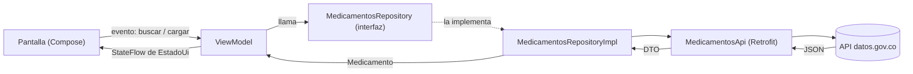
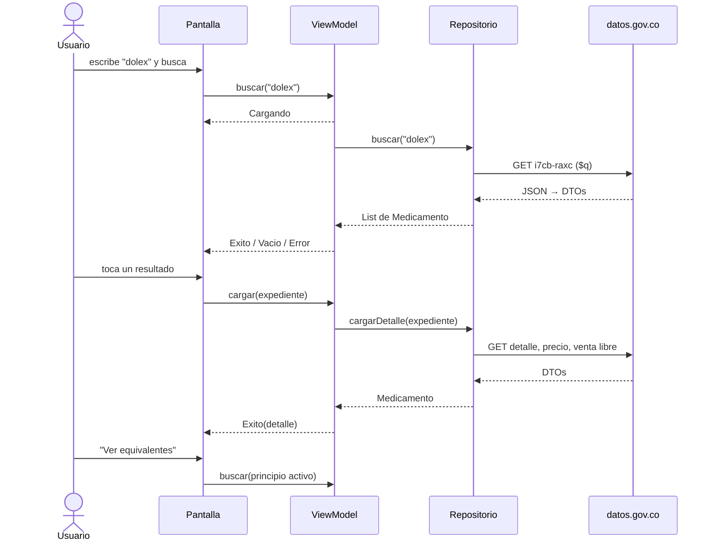

# Tutorial de arquitectura: Remedia

Esta guía explica cómo está organizado Remedia (`com.example.remedia`) y cómo viaja un dato desde la API de datos.gov.co hasta la pantalla. Cada archivo se explica con su responsabilidad y su porqué.

## 1. Idea general

Remedia usa **MVVM** (Model - View - ViewModel):

- **Model**: los datos y de dónde salen (API, DTOs, modelo, repositorio).
- **View**: lo que se dibuja (pantallas y componentes en Jetpack Compose).
- **ViewModel**: el intermediario. Pide datos, guarda el estado y se lo ofrece a la vista.

Regla de oro: **la vista nunca habla con la API**. Cada capa solo conoce a la siguiente: `Pantalla → ViewModel → Repositorio → API`.

## 2. Estructura de carpetas

```text
com.example.remedia/
├── MainActivity.kt
├── data/
│   ├── api/          MedicamentosApi.kt
│   ├── dto/          MedicamentoDto.kt, PrecioDto.kt
│   ├── model/        Medicamento.kt
│   ├── network/      RetrofitClient.kt
│   └── repository/   MedicamentosRepository.kt (interfaz)
│                     MedicamentosRepositoryImpl.kt
├── presentation/
│   ├── components/   Animaciones, BotonCircular, BuscadorBar, ChipFiltro,
│   │                 EstadoChip, EstadoContenido, MedicamentoCard, VentaLibreBadge
│   ├── navigation/   Destinations.kt, AppNavigation.kt
│   ├── screens/      InicioScreen, ResultadosScreen, DetalleScreen, EscanerScreen
│   └── viewmodel/    BusquedaViewModel, DetalleViewModel, EscanerViewModel, EstadoUi
└── ui/theme/         Color.kt, Theme.kt, Type.kt
```

| Carpeta | Responsabilidad |
|---|---|
| `data/api` | Describe los endpoints de la API (Retrofit). |
| `data/dto` | Forma exacta del JSON que devuelve la API. |
| `data/model` | Entidad del dominio: lo que la app entiende por "medicamento". |
| `data/network` | Construye el cliente Retrofit (URL base, Gson, header opcional). |
| `data/repository` | Punto único de acceso a los datos (interfaz + implementación). |
| `presentation/components` | Piezas visuales reutilizables. |
| `presentation/navigation` | Rutas y grafo de navegación. |
| `presentation/screens` | Las 4 pantallas de la app. |
| `presentation/viewmodel` | Estado de cada pantalla. |
| `ui/theme` | Colores, tipografía y tema Material 3. |

## 3. Diagrama del flujo de datos



Lectura: el usuario hace algo en la pantalla, el ViewModel pide el dato al repositorio, el repositorio consulta la API y convierte el DTO en un `Medicamento`. El ViewModel lo deja en un `StateFlow<EstadoUi<...>>` y la pantalla, que lo observa con `collectAsState()`, se redibuja sola.

## 4. Explicación archivo por archivo

### 4.1 Modelo

**`data/dto/MedicamentoDto.kt`**
Copia fiel de una fila del dataset `i7cb-raxc` (CUM vigentes, INVIMA). Todos sus campos son nulables porque la lista de resultados pide solo algunos campos (`$select`) y el detalle trae más. Gson lo llena automáticamente.

**`data/dto/PrecioDto.kt`**
Una fila del dataset `nauz-qkjw` (precio máximo regulado). Usa `@SerializedName` para mapear el nombre largo del campo de la API a `precioMaximo`.

**`data/model/Medicamento.kt`**
La entidad del dominio, ya limpia: sin nulos ni textos vacíos, solo `val`, con `expediente` como id único.

```kotlin
data class Medicamento(
    val expediente: String,
    val nombre: String,
    val laboratorio: String,
    val formaFarmaceutica: String,
    val vigente: Boolean,
    val ventaLibre: Boolean,
    val paraQueSirve: String,
    val principiosActivos: List<String>,
    val registroInvima: String,
    val precioMaximo: String?
)
```

Las pantallas y los ViewModels usan esta clase, nunca los DTOs.

> **Por qué dos clases (DTO y modelo):** si la API cambia un nombre de campo, solo se toca el DTO y el mapeo. La UI no se entera.

### 4.2 Red

**`data/api/MedicamentosApi.kt`**
Interfaz de Retrofit con los 4 endpoints. Todas son funciones `suspend`, así que se llaman desde una corrutina:

| Función | Dataset | Para qué |
|---|---|---|
| `buscar(texto)` | `i7cb-raxc` | Buscar por nombre (`$q`), con `$select`/`$group` de 5 campos y `$limit=50`. |
| `detalle(expediente)` | `i7cb-raxc` | Traer el registro completo de un expediente. |
| `precio(where)` | `nauz-qkjw` | Precio máximo legal (`starts_with(cum, '<expediente>-')`). |
| `ventaLibre(principioActivo)` | `xzwx-qpja` | Saber si el principio activo es de venta libre. |

**`data/network/RetrofitClient.kt`**
`object` que arma Retrofit una sola vez (URL base `https://www.datos.gov.co/`, convertidor Gson, interceptor de logs). Agrega el header `Authorization` (Basic) **solo si** `SOCRATA_KEY_ID` y `SOCRATA_KEY_SECRET` (de `local.properties`, vía `BuildConfig`) no están vacías. La API funciona sin key; la key solo da más cupo de peticiones. Un header vacío podría hacer que el servidor rechace la petición, por eso no se envía.

### 4.3 Repositorio

**`MedicamentosRepository.kt` (interfaz)**
Define *qué* se puede pedir, sin decir *cómo*:

```kotlin
interface MedicamentosRepository {
    suspend fun buscar(texto: String): List<Medicamento>
    suspend fun cargarDetalle(expediente: String): Medicamento?
}
```

**`MedicamentosRepositoryImpl.kt`**
Define *cómo*, usando `MedicamentosApi`:

- `buscar`: llama a `api.buscar` y convierte cada DTO en `Medicamento` (`toMedicamentoBasico()`). En la lista, `ventaLibre` es `false` y `precioMaximo` es `null`, porque esos datos viven en otros datasets y solo se consultan en el detalle.
- `cargarDetalle`: trae el DTO completo (`null` si no existe) y luego consulta el precio y la venta libre. Cada una de esas dos consultas va envuelta en `runCatching`, así que si fallan **no rompen el detalle**: simplemente queda "sin precio" o "requiere fórmula". No todo medicamento tiene precio regulado, así que "sin precio" es un resultado válido, no un error.

> **Por qué una interfaz:** los ViewModels dependen de `MedicamentosRepository`, no de Retrofit. Se puede cambiar la fuente de datos (API, Room, datos falsos para pruebas) sin tocar pantallas ni ViewModels. Por defecto reciben `MedicamentosRepositoryImpl()`.

**Sobre hilos:** el código no usa `Dispatchers`. Las funciones `suspend` de Retrofit ya son seguras para llamarse desde el hilo principal: Retrofit ejecuta la red fuera de él internamente.

### 4.4 ViewModels

**`EstadoUi.kt`**
Los 4 estados visuales posibles de una pantalla con datos:

```kotlin
sealed interface EstadoUi<out T> {
    data object Cargando : EstadoUi<Nothing>
    data class Exito<T>(val datos: T) : EstadoUi<T>
    data object Vacio : EstadoUi<Nothing>
    data class Error(val mensaje: String) : EstadoUi<Nothing>
}
```

**`BusquedaViewModel.kt`**
Sirve a Inicio y a Resultados. Expone dos `StateFlow`:

- `recientes: EstadoUi<List<String>>`: últimas 10 búsquedas, en memoria (no persisten al cerrar la app).
- `resultados: EstadoUi<List<Medicamento>>`: resultado de la búsqueda actual.

`buscar(texto)` ignora textos vacíos, registra el reciente, emite `Cargando`, llama al repositorio y emite `Exito(lista)`, `Vacio` (lista vacía) o `Error(mensaje)` si hubo excepción.

**`DetalleViewModel.kt`**
Expone `estado: EstadoUi<Medicamento>`. `cargar(expediente)` emite `Cargando`, llama a `cargarDetalle` y emite `Exito`, o `Error` si el repositorio devolvió `null` ("No encontramos este medicamento...") o lanzó una excepción.

**`EscanerViewModel.kt`**
`capturar()` emite un `Error` honesto: la cámara aún no está implementada (faltan CameraX y ML Kit). Es un pendiente funcional, no de arquitectura.

> `StateFlow` guarda siempre un último valor. La pantalla lo observa y se redibuja cuando cambia; el ViewModel sobrevive a la rotación del teléfono, así que el estado no se pierde.

### 4.5 Navegación

**`Destinations.kt`**
Un `sealed interface Destination` con las rutas `@Serializable`:

| Ruta | Argumento |
|---|---|
| `Destination.Inicio` | — |
| `Destination.Escaner` | — |
| `Destination.Resultados(consulta)` | texto buscado, o principio activo en "Ver equivalentes" |
| `Destination.Detalle(expediente)` | id del medicamento |

Es *type-safe*: los argumentos viajan como propiedades tipadas, no como strings pegados a una ruta (`"detalle/{expediente}"`).

**`AppNavigation.kt`**
Contiene el `NavHost` con `startDestination = Destination.Inicio`, conecta cada ruta con su pantalla y define a dónde navega cada una. Crea **una sola** instancia de `BusquedaViewModel` y se la pasa a Inicio y Resultados, para que compartan el historial de recientes. `DetalleViewModel` y `EscanerViewModel` los crea cada pantalla con `viewModel()`.

`MainActivity` solo hace esto:

```kotlin
setContent { RemediaTheme { AppNavigation() } }
```

### 4.6 Pantallas

Las pantallas no tienen lógica de negocio: observan el estado, dibujan y avisan eventos hacia arriba con lambdas (`onBuscar`, `onVolver`, `onMedicamentoClick`...).

| Pantalla | Qué hace |
|---|---|
| `InicioScreen` | Buscador, botón "Escanear caja" y recientes (observa `recientes`). |
| `ResultadosScreen` | Lanza `viewModel.buscar(consulta)` con `LaunchedEffect(consulta)`, observa `resultados` y ofrece filtros de venta. |
| `DetalleScreen` | Lanza `viewModel.cargar(expediente)` con `LaunchedEffect(expediente)` y observa `estado`. |
| `EscanerScreen` | UI del escáner; `capturar()` avisa que la cámara no está lista. |

### 4.7 Componentes reutilizables

| Componente | Para qué sirve |
|---|---|
| `EstadoContenido` | Pinta los 4 estados (`Cargando`, `Vacio`, `Error` con botón "Reintentar") y en `Exito` ejecuta el contenido propio de la pantalla. Evita repetir el `when` en cada screen. |
| `MedicamentoCard` | Tarjeta de un medicamento en la lista de resultados. |
| `BuscadorBar` | Barra de búsqueda. |
| `ChipFiltro` | Chip en píldora para los filtros (Todos / Venta libre / Con fórmula). |
| `EstadoChip` | Etiqueta Vigente / Vencido según `vigente`. |
| `VentaLibreBadge` | Insignia "VENTA LIBRE" / "REQUIERE FÓRMULA". |
| `BotonCircular` | Botón redondo (atrás, compartir). |
| `Animaciones` | `Modifier.entradaSuave(indice)`: entrada escalonada (fade + slide-up). |

> Un componente recibe datos y lambdas por parámetro y no conoce ViewModels. Así se reutiliza y se prueba aislado.

## 5. Caso práctico: flujo completo

Escenario: el usuario busca "dolex", abre un resultado y pide equivalentes.

**Paso 1 · Buscar (Inicio)**
El usuario escribe "dolex" y busca. `InicioScreen` llama a `onBuscar("dolex")` y `AppNavigation` navega a `Destination.Resultados("dolex")`.

**Paso 2 · Resultados**
Al aparecer, `ResultadosScreen` ejecuta `viewModel.buscar("dolex")` (vía `LaunchedEffect(consulta)`). En `BusquedaViewModel`:

1. Guarda "dolex" en recientes.
2. Emite `EstadoUi.Cargando` → se ve el indicador de carga.
3. Llama a `repository.buscar("dolex")`.
4. `MedicamentosRepositoryImpl` llama a `api.buscar`, recibe los DTOs y los convierte en `Medicamento`.
5. El ViewModel emite `Exito(lista)`, `Vacio` o `Error(mensaje)`.
6. `EstadoContenido` dibuja el estado: tarjetas, mensaje de vacío o botón "Reintentar".

**Paso 3 · Detalle**
El usuario toca una tarjeta → `onMedicamentoClick(expediente)` → `Destination.Detalle(expediente)`. `DetalleScreen` ejecuta `viewModel.cargar(expediente)`. El repositorio hace hasta 3 consultas: `detalle` (obligatoria), `precio` y `ventaLibre` (las dos opcionales). Se muestra para qué sirve, principios activos, venta libre / fórmula, registro INVIMA y precio máximo si existe.

**Paso 4 · "Ver equivalentes"**
El botón llama a `onVerEquivalentes` con el **primer principio activo** del medicamento (o su nombre si no tiene). `AppNavigation` navega a `Destination.Resultados(principioActivo)`. No hay un endpoint separado: se reutiliza `buscar` con ese principio activo como `$q`, y `BusquedaViewModel` repite el ciclo del Paso 2.



## 6. Pendientes

- **Pruebas unitarias** de `BusquedaViewModel` y `DetalleViewModel`: agregar `kotlinx-coroutines-test` y un repositorio falso que implemente `MedicamentosRepository`. Hoy solo existe el `ExampleUnitTest` de la plantilla.
- **Escáner**: integrar CameraX y ML Kit para leer el nombre de la caja.
- **Persistencia**: los recientes viven en memoria; Room/DataStore están pendientes.